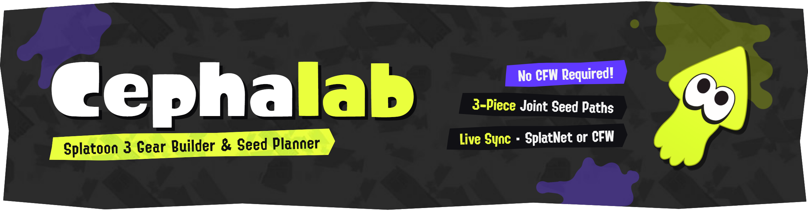
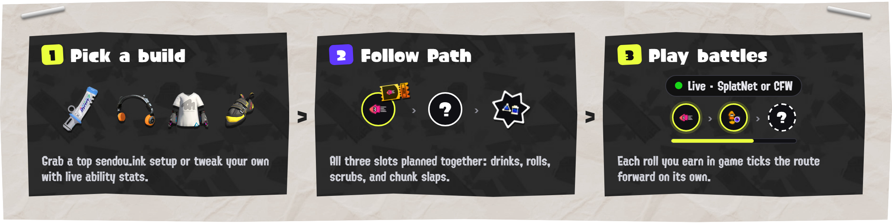
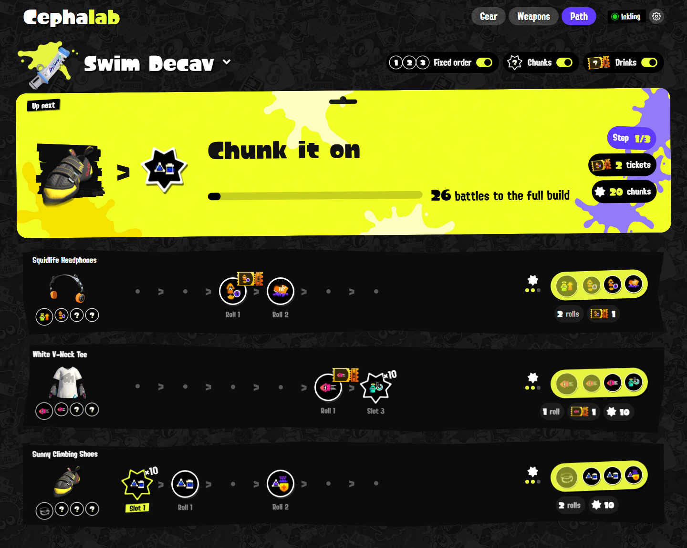
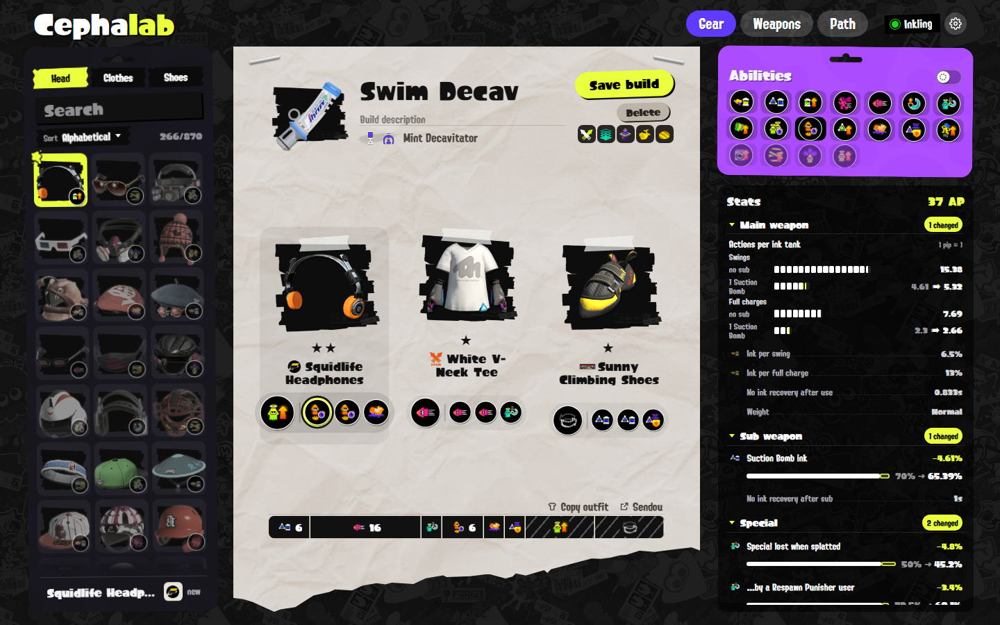
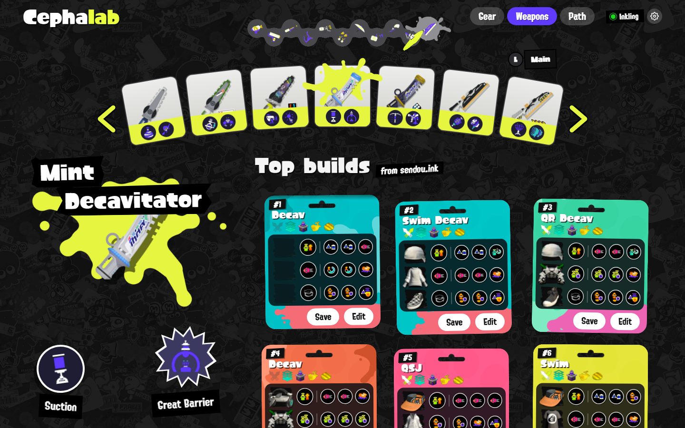
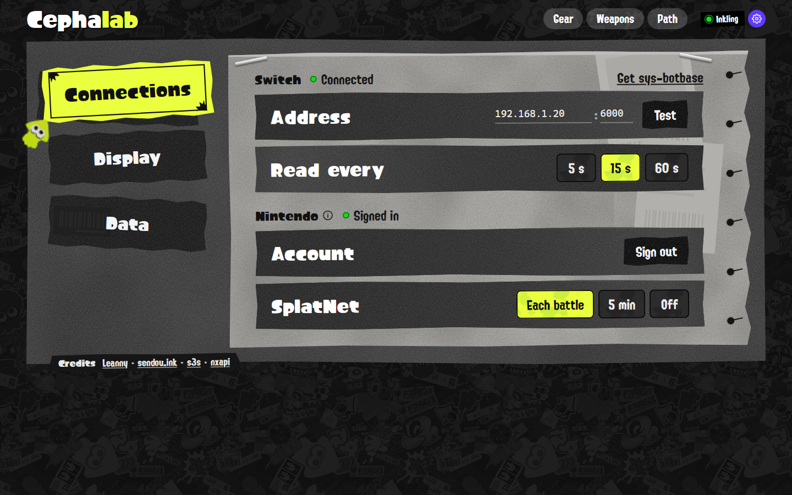
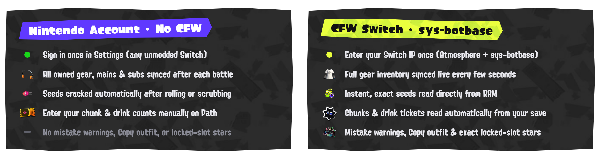

<h1 align="center">
  
</h1>

**Cephalab** plans the shortest path of rolls, drink tickets, and chunks to finish your Splatoon 3 builds. Connect a Nintendo account or a modded Switch, pick a build, and it ticks every step forward as you play.

<p align="center">
  <a href="#install"></a>
  <a href="#using-it"></a>
  <a href="#good-to-know"></a>
  <a href="#credits"></a>
  <a href="https://github.com/Lii-lac/cephalab/issues/new/choose"></a>
</p>


### Install

You need Windows 10 or 11 and either a Nintendo Switch Online account or a Switch running Atmosphere with [sys-botbase](https://github.com/olliz0r/sys-botbase/releases).

1. Download `cephalab.exe` from the latest release.
2. Run it. It opens in your browser at `http://127.0.0.1:8765`.
3. Open **Settings** (gear icon, top right) and connect:
   - **Nintendo account:** Click **Sign in**, right-click *Select this person* on Nintendo's page, copy the link, and paste it back into Cephalab.
   - **CFW Switch:** Install [sys-botbase](https://github.com/olliz0r/sys-botbase/releases), reboot into Atmosphere, and enter your Switch's IP (*System Settings → Internet*).

When your player name shows in the top-right pill, it's working.

<details>
<summary>Building from source</summary>

<br>

```bash
bash core/build.sh && node tests/core/run_tests.mjs          # C++ core -> wasm + tests
.venv\Scripts\python.exe -m unittest tests.companion.test_companion
cd web && npm run build
.venv\Scripts\python.exe tools\build_exe.py                  # dist\cephalab.exe
```

- Fake Switch for testing: `python tests/fake_botbase.py --stock --roll-every 20`
- Check chunk/drink RAM offsets: `.venv\Scripts\python.exe tools\find_stock.py`
- Core contract: [core/API.md](core/API.md)

</details>


### Using it



Pick a popular build under **Weapons** or build your own in the editor, then open **Path**. Cephalab plans your hat, shirt, and shoes together across the same battles and updates after every roll.

<table>
  <tr>
    <td width="50%" valign="top">
      <br>
      <strong>Path</strong><br>
      Plans all three pieces together, balancing drink tickets, scrubs, swaps, and chunk slaps.
    </td>
    <td width="50%" valign="top">
      <br>
      <strong>Build Editor</strong><br>
      Pick weapons, gear, mains, and subs with live ability stats.
    </td>
  </tr>
  <tr>
    <td width="50%" valign="top">
      <br>
      <strong>Weapons</strong><br>
      Browse top builds per weapon from <a href="https://sendou.ink/">sendou.ink</a> and save your own under <strong>Gear</strong>.
    </td>
    <td width="50%" valign="top">
      <br>
      <strong>Settings</strong><br>
      Switch or Nintendo sync, display zoom, and build import/export.
    </td>
  </tr>
</table>


### Good to know



**Privacy.** Nintendo login tokens stay in Windows Credential Manager and are never saved in files. Sign-in authenticates with Nintendo through [nxapi](https://github.com/samuelthomas2774/nxapi-znca-api).

**No login.** If you'd rather not sign in, you can import an `s3s --getseed` JSON file under **Settings → Data**.

**CFW safety.** Cephalab only reads Switch memory and never writes to the game, though going online on Atmosphere always carries some risk.


### Credits

| | |
| :--- | :--- |
| [Leanny](https://leanny.github.io/) | Splatoon 3 data, game images, seed math, and idea |
| [sendou.ink](https://sendou.ink/) | Popular community builds and idea |
| [s3s](https://github.com/frozenpandaman/s3s) | SplatNet 3 integration |
| [nxapi](https://github.com/samuelthomas2774/nxapi-znca-api) | Nintendo Switch Online sign-in |
| LegoFigure11 / Splat3GearView | Switch memory offsets |

### License

Free and open source under [GPL-3.0](LICENSE) (you can use, share, and modify it as long as changes stay open source too). Includes [s3s](https://github.com/frozenpandaman/s3s) (GPL-3.0) and [three.js](assets/three-r159-LICENSE.txt) (MIT).
